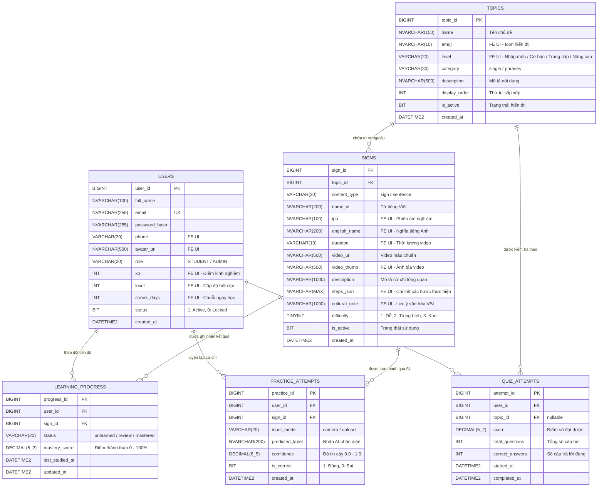

# Thiết kế Cơ sở Dữ liệu Hệ thống Học Ngôn ngữ Ký hiệu Việt Nam (VSL-DB)
### Tương thích & Đồng bộ toàn diện với Frontend (8 Màn hình UI & Data Models)

> **Dự án:** Hệ thống học và thực hành Ngôn ngữ ký hiệu Việt Nam (VSL) - BTL Nhóm 4  
> **Hệ quản trị CSDL:** Microsoft SQL Server  
> **Đồng bộ Frontend:** 8 Màn hình giao diện (Web Screen Portal `screens/` & React Native App `src/`) và dữ liệu [`mockData.js`](file:///d:/ky1nam4/TTNM/FE/src/data/mockData.js).

---

## 1. Sơ đồ Quan hệ Thực thể Chuẩn hóa (ERD)

Mô hình dữ liệu giữ nguyên 6 thực thể cốt lõi theo đề cương nghiên cứu BTL, đồng thời mở rộng các trường thuộc tính để phục vụ 100% các thành phần UI đang hiển thị trên 8 màn hình Frontend:



---

## 2. Bảng Ánh xạ giữa 8 Màn hình Frontend và Cơ sở Dữ liệu (Screen-to-DB Mapping)

Hệ thống FE hiện đã xây dựng 8 màn hình (bao gồm cả mã nguồn HTML Web tại [`screens/`](file:///d:/ky1nam4/TTNM/FE/screens/) và React Native Component tại [`src/screens/`](file:///d:/ky1nam4/TTNM/FE/src/screens/)). Bảng dưới đây thể hiện sự kết nối chính xác giữa từng màn hình với các bảng CSDL:

| STT | Màn hình Frontend (Web & App) | File Screen trong FE | Bảng CSDL Truy vấn | Các trường tương ứng từ CSDL lên UI |
| :---: | :--- | :--- | :--- | :--- |
| **01** | **Kiểm Tra Kiến Thức Quiz** | `screens/01_kiem_tra_quiz`<br/>[`src/screens/QuizScreen.js`](file:///d:/ky1nam4/TTNM/FE/src/screens/QuizScreen.js) | `TOPICS`<br/>`SIGNS`<br/>`QUIZ_ATTEMPTS` | • Câu hỏi lấy từ `SIGNS.video_url`, `SIGNS.name_vi`<br/>• Kết quả lưu vào `QUIZ_ATTEMPTS (score, correct_answers, total_questions)` |
| **02** | **Chi Tiết Chủ Đề Bài Học** | `screens/02_chi_tiet_chu_de_chao_hoi`<br/>[`src/screens/TopicDetailScreen.js`](file:///d:/ky1nam4/TTNM/FE/src/screens/TopicDetailScreen.js) | `TOPICS`<br/>`SIGNS`<br/>`LEARNING_PROGRESS` | • Thông tin chủ đề: `TOPICS (name, emoji, level, description)`<br/>• Danh sách từ vựng: `SIGNS (name_vi, ipa, english_name, video_thumb, duration)`<br/>• Trạng thái học từng từ: `LEARNING_PROGRESS.status` |
| **03** | **Phòng Thực Hành AI Camera** | `screens/03_phong_thuc_hanh_ai_camera`<br/>[`src/screens/AICameraScreen.js`](file:///d:/ky1nam4/TTNM/FE/src/screens/AICameraScreen.js) | `SIGNS`<br/>`PRACTICE_ATTEMPTS`<br/>`LEARNING_PROGRESS` | • Ký hiệu mục tiêu: `SIGNS (name_vi, video_url, description)`<br/>• Kết quả AI trả về lưu vào `PRACTICE_ATTEMPTS (predicted_label, confidence, is_correct)`<br/>• Cập nhật điểm thành thạo `LEARNING_PROGRESS.mastery_score` |
| **04** | **Đăng Nhập Tài Khoản** | `screens/04_dang_nhap_tai_khoan`<br/>[`src/screens/LoginScreen.js`](file:///d:/ky1nam4/TTNM/FE/src/screens/LoginScreen.js) | `USERS` | • Kiểm tra `USERS.email` và `USERS.password_hash`<br/>• Trả về JWT Token và thông tin `USERS (user_id, full_name, role)` |
| **05** | **Hồ Sơ Cá Nhân & Thành Tích** | `screens/05_ho_so_ca_nhan_thanh_tich`<br/>[`src/screens/ProfileScreen.js`](file:///d:/ky1nam4/TTNM/FE/src/screens/ProfileScreen.js) | `USERS`<br/>`LEARNING_PROGRESS`<br/>`PRACTICE_ATTEMPTS`<br/>`QUIZ_ATTEMPTS` | • Thông tin học viên: `USERS (full_name, email, phone, avatar_url, xp, level, streak_days)`<br/>• Thống kê từ thành thạo: `COUNT(LEARNING_PROGRESS.status = 'mastered')`<br/>• Độ chính xác AI trung bình: `AVG(PRACTICE_ATTEMPTS.confidence)` |
| **06** | **Chi Tiết Ký Hiệu** | `screens/06_chi_tiet_ky_hieu`<br/>[`src/screens/SignDetailScreen.js`](file:///d:/ky1nam4/TTNM/FE/src/screens/SignDetailScreen.js) | `SIGNS`<br/>`LEARNING_PROGRESS` | • Video & hướng dẫn: `SIGNS (name_vi, ipa, video_url, steps_json, cultural_note)`<br/>• Điểm AI cá nhân cao nhất: `LEARNING_PROGRESS.mastery_score` |
| **07** | **Danh Mục Chủ Đề** | `screens/07_danh_muc_chu_de`<br/>[`src/screens/TopicsScreen.js`](file:///d:/ky1nam4/TTNM/FE/src/screens/TopicsScreen.js) | `TOPICS`<br/>`SIGNS`<br/>`LEARNING_PROGRESS` | • Thẻ chủ đề: `TOPICS (topic_id, name, emoji, level, category)`<br/>• Số lượng ký hiệu: `COUNT(SIGNS.sign_id)` theo `topic_id`<br/>• Tiến độ chủ đề: Phần trăm ký hiệu `mastered` trong chủ đề |
| **08** | **Trang Chủ & Tiến Độ** | `screens/08_trang_chu_tien_do`<br/>[`src/screens/HomeScreen.js`](file:///d:/ky1nam4/TTNM/FE/src/screens/HomeScreen.js) | `USERS`<br/>`TOPICS`<br/>`SIGNS`<br/>`LEARNING_PROGRESS` | • Header cá nhân: `USERS (full_name, avatar_url, streak_days)`<br/>• Chủ đề đang học: `TOPICS` có lần học gần nhất<br/>• Danh sách từ cần ôn tập: `SIGNS` có `LEARNING_PROGRESS.status = 'review'` |

---

## 3. Chi tiết Danh sách Bảng và Cấu trúc Thuộc tính Thích ứng

### 3.1. Bảng `USERS` (Người dùng & Thông tin Học tập)
Đồng bộ trực tiếp với đối tượng `USER_PROFILE` trong [`src/data/mockData.js`](file:///d:/ky1nam4/TTNM/FE/src/data/mockData.js#L1-L18).

| Tên trường | Kiểu dữ liệu | Ràng buộc | Null | Thuộc tính FE tương ứng | Mô tả chi tiết |
| :--- | :--- | :--- | :---: | :--- | :--- |
| `user_id` | `BIGINT` | PK, IDENTITY(1,1) | K | `id` | Định danh duy nhất của người dùng |
| `full_name` | `NVARCHAR(100)` | | K | `name` | Họ tên hiển thị trên TopBar Home và Profile |
| `email` | `NVARCHAR(255)` | UNIQUE, INDEX | K | `email` | Email đăng nhập hệ thống |
| `password_hash` | `NVARCHAR(255)` | | K | `password` | Mật khẩu băm (BCrypt) |
| `phone` | `VARCHAR(20)` | | C | `phone` | Số điện thoại liên hệ cá nhân |
| `avatar_url` | `NVARCHAR(500)` | | C | `avatarUrl` | Link ảnh đại diện (Unsplash / Storage CDN) |
| `role` | `VARCHAR(20)` | DEFAULT `'STUDENT'` | K | `role` | Vai trò: `STUDENT` hoặc `ADMIN` |
| `xp` | `INT` | DEFAULT `0` | K | `xp` | Điểm kinh nghiệm tích lũy để thăng hạng |
| `level` | `INT` | DEFAULT `1` | K | `level` | Cấp bậc người học (1: Nhập môn, 2, 3: Tự tin...) |
| `streak_days` | `INT` | DEFAULT `0` | K | `streakDays` | Số ngày học liên tục (Hiển thị biểu tượng ngọn lửa) |
| `status` | `BIT` | DEFAULT `1` | K | - | 1: Hoạt động bình thường, 0: Khóa tài khoản |
| `created_at` | `DATETIME2` | DEFAULT `GETDATE()` | K | - | Thời điểm đăng ký tài khoản |

---

### 3.2. Bảng `TOPICS` (Chủ đề Bài học)
Đồng bộ trực tiếp với mảng `TOPICS` trong [`src/data/mockData.js`](file:///d:/ky1nam4/TTNM/FE/src/data/mockData.js#L20-L117).

| Tên trường | Kiểu dữ liệu | Ràng buộc | Null | Thuộc tính FE tương ứng | Mô tả chi tiết |
| :--- | :--- | :--- | :---: | :--- | :--- |
| `topic_id` | `BIGINT` | PK, IDENTITY(1,1) | K | `id` (`topic_01`...) | Định danh chủ đề |
| `name` | `NVARCHAR(150)` | | K | `title` | Tên chủ đề (ví dụ: "Chào hỏi & Xã giao") |
| `emoji` | `NVARCHAR(10)` | | C | `emoji` | Biểu tượng cảm xúc đại diện (👋, 👨‍👩‍👧, 🔤, 😊...) |
| `level` | `NVARCHAR(30)` | DEFAULT `'Cơ bản'` | K | `level` | Cấp độ chủ đề: "Nhập môn", "Cơ bản", "Trung cấp", "Nâng cao" |
| `category` | `VARCHAR(30)` | DEFAULT `'single'` | K | `category` | Phân loại từ: `'single'` (từ đơn) hoặc `'phrases'` (cụm từ/câu) |
| `description` | `NVARCHAR(500)` | | C | `description` | Mô tả ngắn tóm tắt nội dung bài học |
| `display_order` | `INT` | DEFAULT `0` | K | `number` | Thứ tự bài học hiển thị từ 1 đến 8 |
| `is_active` | `BIT` | DEFAULT `1` | K | `status` | 1: Hoạt động, 0: Đang khóa (`locked`) |
| `created_at` | `DATETIME2` | DEFAULT `GETDATE()` | K | - | Thời điểm tạo chủ đề |

---

### 3.3. Bảng `SIGNS` (Ký hiệu Từ vựng & Câu mẫu)
Đồng bộ trực tiếp với mảng `VOCABULARY_LIST` trong [`src/data/mockData.js`](file:///d:/ky1nam4/TTNM/FE/src/data/mockData.js#L119-L245).

| Tên trường | Kiểu dữ liệu | Ràng buộc | Null | Thuộc tính FE tương ứng | Mô tả chi tiết |
| :--- | :--- | :--- | :---: | :--- | :--- |
| `sign_id` | `BIGINT` | PK, IDENTITY(1,1) | K | `id` (`sign_01`...) | Định danh ký hiệu |
| `topic_id` | `BIGINT` | FK (`TOPICS.topic_id`) | K | - | Thuộc chủ đề nào |
| `content_type` | `VARCHAR(20)` | DEFAULT `'sign'` | K | `type` | `'sign'` (từ đơn) hoặc `'sentence'` / `'phrases'` |
| `name_vi` | `NVARCHAR(200)` | | K | `word` | Tên từ/câu tiếng Việt ("Xin chào", "Cảm ơn"...) |
| `ipa` | `NVARCHAR(100)` | | C | `ipa` | Phiên âm ngữ âm học quốc tế IPA |
| `english_name` | `NVARCHAR(200)` | | C | `english` | Dịch nghĩa tiếng Anh ("Hello", "Thank you"...) |
| `duration` | `VARCHAR(10)` | DEFAULT `'0:03'` | K | `duration` | Thời lượng video ký hiệu (ví dụ: "0:03", "0:05") |
| `video_url` | `NVARCHAR(500)` | | K | - | Đường dẫn stream video mẫu chuẩn |
| `video_thumb` | `NVARCHAR(500)` | | C | `videoThumb` | Đường dẫn ảnh đại diện/thumbnail của video |
| `description` | `NVARCHAR(1000)`| | C | `description` | Tóm tắt cử động ngắn gọn |
| `steps_json` | `NVARCHAR(MAX)` | | C | `steps` | Chuỗi JSON chứa các bước thực hiện chi tiết |
| `cultural_note` | `NVARCHAR(1000)`| | C | `culturalNote` | Lưu ý ý nghĩa văn hóa khi dùng ký hiệu VSL |
| `difficulty` | `TINYINT` | DEFAULT `1` | K | - | 1: Cơ bản, 2: Trung bình, 3: Nâng cao |
| `is_active` | `BIT` | DEFAULT `1` | K | - | 1: Hiển thị học, 0: Tạm ẩn |
| `created_at` | `DATETIME2` | DEFAULT `GETDATE()` | K | - | Ngày tạo ký hiệu |

> **Cấu trúc trường `steps_json`:** Lưu trữ mảng đối tượng JSON tương thích với UI màn hình `SignDetailScreen`:
> ```json
> [
>   {"step": 1, "title": "Tư thế bắt đầu", "detail": "Đưa bàn tay phải lên ngang tầm mắt..."},
>   {"step": 2, "title": "Cử động vẫy", "detail": "Các ngón tay khép nhẹ, vẫy cổ tay 2 nhịp..."}
> ]
> ```

---

### 3.4. Bảng `LEARNING_PROGRESS` (Tiến trình Học tập Cá nhân)
Theo dõi trạng thái hoàn thành từng ký hiệu trên `HomeScreen`, `TopicDetailScreen` và `ProfileScreen`.

| Tên trường | Kiểu dữ liệu | Ràng buộc | Null | Thuộc tính FE tương ứng | Mô tả chi tiết |
| :--- | :--- | :--- | :---: | :--- | :--- |
| `progress_id` | `BIGINT` | PK, IDENTITY(1,1) | K | - | Định danh dòng tiến độ |
| `user_id` | `BIGINT` | FK (`USERS.user_id`) | K | - | Học viên |
| `sign_id` | `BIGINT` | FK (`SIGNS.sign_id`) | K | `id` ký hiệu | Ký hiệu đang học |
| `status` | `VARCHAR(20)` | DEFAULT `'unlearned'` | K | `status` | `'unlearned'` (chưa học), `'review'` (cần ôn), `'mastered'` (thuần thục) |
| `mastery_score`| `DECIMAL(5,2)` | DEFAULT `0.00` | K | `aiScore` | Điểm chuẩn xác (thang điểm 0 - 100) |
| `last_studied_at`| `DATETIME2` | | C | - | Thời gian gần nhất học từ này |
| `updated_at` | `DATETIME2` | DEFAULT `GETDATE()` | K | - | Thời điểm cập nhật tiến độ |

---

### 3.5. Bảng `QUIZ_ATTEMPTS` (Lịch sử Thi Trắc nghiệm)
Đồng bộ với màn hình [`src/screens/QuizScreen.js`](file:///d:/ky1nam4/TTNM/FE/src/screens/QuizScreen.js) và bộ câu hỏi `QUIZ_QUESTIONS`.

| Tên trường | Kiểu dữ liệu | Ràng buộc | Null | Thuộc tính FE tương ứng | Mô tả chi tiết |
| :--- | :--- | :--- | :---: | :--- | :--- |
| `attempt_id` | `BIGINT` | PK, IDENTITY(1,1) | K | - | Mã lượt thi |
| `user_id` | `BIGINT` | FK (`USERS.user_id`) | K | - | Học viên thực hiện bài quiz |
| `topic_id` | `BIGINT` | FK (`TOPICS.topic_id`) | C | - | Chủ đề làm bài (hoặc NULL nếu là bài tổng hợp) |
| `score` | `DECIMAL(5,2)` | | K | `score` | Điểm số đạt được (0.00 - 100.00) |
| `total_questions`| `INT` | | K | `QUIZ_QUESTIONS.length` | Tổng số câu hỏi trong bài kiểm tra (ví dụ: 3, 5, 10 câu) |
| `correct_answers`| `INT` | | K | `correctCount` | Số câu học viên trả lời chính xác |
| `started_at` | `DATETIME2` | DEFAULT `GETDATE()` | K | - | Thời điểm bấm bắt đầu làm bài |
| `completed_at` | `DATETIME2` | | C | - | Thời điểm nộp bài hoàn tất |

---

### 3.6. Bảng `PRACTICE_ATTEMPTS` (Lịch sử Luyện Cử chỉ AI Camera)
Đồng bộ với màn hình [`src/screens/AICameraScreen.js`](file:///d:/ky1nam4/TTNM/FE/src/screens/AICameraScreen.js) khi người học bật camera đối chiếu khớp cử chỉ.

| Tên trường | Kiểu dữ liệu | Ràng buộc | Null | Thuộc tính FE tương ứng | Mô tả chi tiết |
| :--- | :--- | :--- | :---: | :--- | :--- |
| `practice_id` | `BIGINT` | PK, IDENTITY(1,1) | K | - | Mã phiên thực hành cử chỉ |
| `user_id` | `BIGINT` | FK (`USERS.user_id`) | K | - | Học viên thực hành |
| `sign_id` | `BIGINT` | FK (`SIGNS.sign_id`) | K | `sign.id` | Ký hiệu đang được yêu cầu thực hiện |
| `input_mode` | `VARCHAR(20)` | DEFAULT `'camera'` | K | - | Phương thức: `'camera'` (trực tiếp) hoặc `'upload'` |
| `predicted_label`| `NVARCHAR(200)`| | C | - | Nhãn ký hiệu mà AI phán đoán được |
| `confidence` | `DECIMAL(6,5)` | | C | `accuracy / 100` | Độ chuẩn xác AI đo lường (ví dụ: 0.94000 = 94%) |
| `is_correct` | `BIT` | | C | `isSuccess` | 1: Đạt chuẩn (được hiển thị modal chúc mừng), 0: Chưa chuẩn |
| `created_at` | `DATETIME2` | DEFAULT `GETDATE()` | K | - | Thời điểm bấm Chụp / Hoàn thành cử chỉ |

---

## 4. Script Tạo Bảng Tương Thích Hoàn Toàn (SQL Server DDL)

```sql
-- ========================================================
-- DATABASE SCHEMA CHO HỆ THỐNG VSL (ĐỒNG BỘ 8 MÀN HÌNH FE)
-- ========================================================

-- 1. Bảng USERS
CREATE TABLE USERS (
    user_id BIGINT IDENTITY(1,1) PRIMARY KEY,
    full_name NVARCHAR(100) NOT NULL,
    email NVARCHAR(255) NOT NULL UNIQUE,
    password_hash NVARCHAR(255) NOT NULL,
    phone VARCHAR(20) NULL,
    avatar_url NVARCHAR(500) NULL,
    role VARCHAR(20) NOT NULL DEFAULT 'STUDENT',
    xp INT NOT NULL DEFAULT 0,
    level INT NOT NULL DEFAULT 1,
    streak_days INT NOT NULL DEFAULT 0,
    status BIT NOT NULL DEFAULT 1,
    created_at DATETIME2 NOT NULL DEFAULT GETDATE()
);

-- 2. Bảng TOPICS
CREATE TABLE TOPICS (
    topic_id BIGINT IDENTITY(1,1) PRIMARY KEY,
    name NVARCHAR(150) NOT NULL,
    emoji NVARCHAR(10) NULL,
    level NVARCHAR(30) NOT NULL DEFAULT N'Cơ bản',
    category VARCHAR(30) NOT NULL DEFAULT 'single',
    description NVARCHAR(500) NULL,
    display_order INT NOT NULL DEFAULT 0,
    is_active BIT NOT NULL DEFAULT 1,
    created_at DATETIME2 NOT NULL DEFAULT GETDATE()
);

-- 3. Bảng SIGNS
CREATE TABLE SIGNS (
    sign_id BIGINT IDENTITY(1,1) PRIMARY KEY,
    topic_id BIGINT NOT NULL,
    content_type VARCHAR(20) NOT NULL DEFAULT 'sign',
    name_vi NVARCHAR(200) NOT NULL,
    ipa NVARCHAR(100) NULL,
    english_name NVARCHAR(200) NULL,
    duration VARCHAR(10) NOT NULL DEFAULT '0:03',
    video_url NVARCHAR(500) NOT NULL,
    video_thumb NVARCHAR(500) NULL,
    description NVARCHAR(1000) NULL,
    steps_json NVARCHAR(MAX) NULL,
    cultural_note NVARCHAR(1000) NULL,
    difficulty TINYINT NOT NULL DEFAULT 1,
    is_active BIT NOT NULL DEFAULT 1,
    created_at DATETIME2 NOT NULL DEFAULT GETDATE(),
    CONSTRAINT FK_Signs_Topics FOREIGN KEY (topic_id) REFERENCES TOPICS(topic_id)
);

-- 4. Bảng LEARNING_PROGRESS
CREATE TABLE LEARNING_PROGRESS (
    progress_id BIGINT IDENTITY(1,1) PRIMARY KEY,
    user_id BIGINT NOT NULL,
    sign_id BIGINT NOT NULL,
    status VARCHAR(20) NOT NULL DEFAULT 'unlearned',
    mastery_score DECIMAL(5,2) NOT NULL DEFAULT 0.00,
    last_studied_at DATETIME2 NULL,
    updated_at DATETIME2 NOT NULL DEFAULT GETDATE(),
    CONSTRAINT FK_Progress_Users FOREIGN KEY (user_id) REFERENCES USERS(user_id),
    CONSTRAINT FK_Progress_Signs FOREIGN KEY (sign_id) REFERENCES SIGNS(sign_id),
    CONSTRAINT UQ_User_Sign UNIQUE (user_id, sign_id)
);

-- 5. Bảng QUIZ_ATTEMPTS
CREATE TABLE QUIZ_ATTEMPTS (
    attempt_id BIGINT IDENTITY(1,1) PRIMARY KEY,
    user_id BIGINT NOT NULL,
    topic_id BIGINT NULL,
    score DECIMAL(5,2) NOT NULL DEFAULT 0.00,
    total_questions INT NOT NULL,
    correct_answers INT NOT NULL,
    started_at DATETIME2 NOT NULL DEFAULT GETDATE(),
    completed_at DATETIME2 NULL,
    CONSTRAINT FK_Quiz_Users FOREIGN KEY (user_id) REFERENCES USERS(user_id),
    CONSTRAINT FK_Quiz_Topics FOREIGN KEY (topic_id) REFERENCES TOPICS(topic_id)
);

-- 6. Bảng PRACTICE_ATTEMPTS
CREATE TABLE PRACTICE_ATTEMPTS (
    practice_id BIGINT IDENTITY(1,1) PRIMARY KEY,
    user_id BIGINT NOT NULL,
    sign_id BIGINT NOT NULL,
    input_mode VARCHAR(20) NOT NULL DEFAULT 'camera',
    predicted_label NVARCHAR(200) NULL,
    confidence DECIMAL(6,5) NULL,
    is_correct BIT NULL,
    created_at DATETIME2 NOT NULL DEFAULT GETDATE(),
    CONSTRAINT FK_Practice_Users FOREIGN KEY (user_id) REFERENCES USERS(user_id),
    CONSTRAINT FK_Practice_Signs FOREIGN KEY (sign_id) REFERENCES SIGNS(sign_id)
);
```
