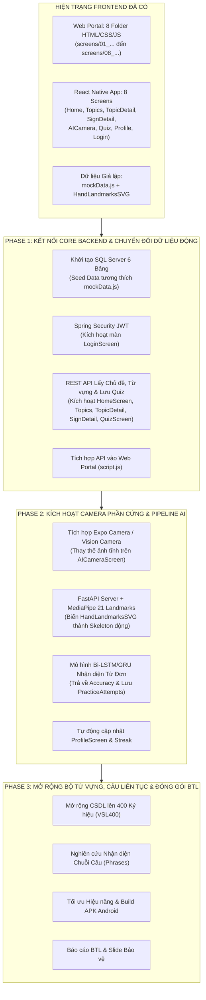

# Kế hoạch Triển khai & Phân chia Giai đoạn (VSL-Phase)
### Thích ứng với Kiến trúc Frontend Hiện có (8 Màn hình UI & Component Tree)

> **Dự án:** Hệ thống học và thực hành Ngôn ngữ ký hiệu Việt Nam (VSL) - BTL Nhóm 4  
> **Hiện trạng Frontend:**  
> • Web Screen Portal: 8 thư mục giao diện HTML/CSS/JS tại [`screens/`](file:///d:/ky1nam4/TTNM/FE/screens/) kèm [`screens/style.css`](file:///d:/ky1nam4/TTNM/FE/screens/style.css) dùng chung.  
> • Ứng dụng Mobile: 8 Screen Components hoàn chỉnh tại [`src/screens/`](file:///d:/ky1nam4/TTNM/FE/src/screens/) điều hướng qua [`AppNavigator.js`](file:///d:/ky1nam4/TTNM/FE/src/navigation/AppNavigator.js), sử dụng dữ liệu tĩnh từ [`mockData.js`](file:///d:/ky1nam4/TTNM/FE/src/data/mockData.js).

---

## 1. Lộ trình Triển khai Tổng thể (Roadmap Gắn liền với FE)

---

## 2. Chi tiết Công việc & Cách làm theo Từng Giai đoạn

---

### GIAI ĐOẠN 1 (PHASE 1): Kết nối Core Backend & Chuyển đổi Dữ liệu Động cho 8 Màn hình FE

*Mục tiêu:* Thay thế toàn bộ dữ liệu tĩnh [`mockData.js`](file:///d:/ky1nam4/TTNM/FE/src/data/mockData.js) bằng các lệnh gọi API thực tế tới Backend Spring Boot, đưa 8 màn hình giao diện đã có vào luồng hoạt động chính thống.

#### 1. Màn hình Đăng Nhập (`screens/04_dang_nhap_tai_khoan` & `LoginScreen.js`)
* **Chức năng cần làm:**
  - Nhận Email và Mật khẩu từ người dùng, gửi request xác thực.
  - Lưu JWT Token vào `AsyncStorage` (Mobile) và `localStorage` (Web).
  - Điều hướng sang `HomeScreen` sau khi đăng nhập thành công.
* **Cách thực hiện:**
  - **Backend:** Xây dựng `AuthController` (`POST /api/auth/login`, `POST /api/auth/register`) với Spring Security 6 và BCrypt.
  - **Frontend:** Trong [`LoginScreen.js`](file:///d:/ky1nam4/TTNM/FE/src/screens/LoginScreen.js), thay thế hàm xử lý giả lập bằng hàm `handleLogin` gọi `axios.post('/api/auth/login', { email, password })`. Lưu token và cập nhật trạng thái đăng nhập toàn cục (React Context / Redux).

#### 2. Màn hình Trang Chủ & Tiến Độ (`screens/08_trang_chu_tien_do` & `HomeScreen.js`)
* **Chức năng cần làm:**
  - Hiển thị thông tin người học: Tên, avatar, chuỗi ngày học (`streakDays`).
  - Hiển thị chủ đề đang học gần nhất (`currentTopic`) kèm thanh tiến độ hoàn thành hình tròn ([`CircularProgress.js`](file:///d:/ky1nam4/TTNM/FE/src/components/CircularProgress.js)).
  - Hiển thị danh sách từ vựng cần ôn tập (`VOCABULARY_LIST` có `status = 'review'`).
* **Cách thực hiện:**
  - **Backend:** Viết API `GET /api/users/dashboard` trả về DTO tổng hợp gồm thông tin user từ bảng `USERS`, chủ đề gần nhất từ `TOPICS` và danh sách từ vựng liên kết qua `LEARNING_PROGRESS`.
  - **Frontend:** Sử dụng `useEffect` trong [`HomeScreen.js`](file:///d:/ky1nam4/TTNM/FE/src/screens/HomeScreen.js) để fetch dữ liệu từ API khi màn hình được mount, gán vào State thay vì đọc hằng số tĩnh.

#### 3. Màn hình Danh Mục Chủ Đề (`screens/07_danh_muc_chu_de` & `TopicsScreen.js`)
* **Chức năng cần làm:**
  - Hiển thị danh sách 8 chủ đề giao tiếp cơ bản (Chào hỏi, Gia đình, Chữ cái & Số đếm...).
  - Tìm kiếm chủ đề theo từ khóa và lọc theo tab cấp độ: "Tất cả", "Cơ bản", "Trung cấp", "Nâng cao".
  - Tính toán số lượng ký hiệu (`signsCount`) và phần trăm tiến độ đã học (`progress`).
* **Cách thực hiện:**
  - **Backend:** Cung cấp API `GET /api/topics?level={level}&search={keyword}` truy vấn bảng `TOPICS`, kết hợp `LEFT JOIN SIGNS` và `LEARNING_PROGRESS` để tính toán tiến độ tương ứng với `user_id`.
  - **Frontend:** Cập nhật State danh sách chủ đề trong [`TopicsScreen.js`](file:///d:/ky1nam4/TTNM/FE/src/screens/TopicsScreen.js), xử lý thanh tìm kiếm `TextInput` và các nút bấm tab lọc.

#### 4. Màn hình Chi Tiết Chủ Đề & Chi Tiết Ký Hiệu (`screens/02_...`, `screens/06_...`, `TopicDetailScreen.js`, `SignDetailScreen.js`)
* **Chức năng cần làm:**
  - `TopicDetailScreen`: Hiển thị danh sách thẻ từ vựng với ảnh đại diện video, phiên âm IPA, nghĩa tiếng Anh và trạng thái học.
  - `SignDetailScreen`: Phát video mẫu trực tiếp từ `SIGNS.video_url`, hiển thị từng bước hướng dẫn cử động (parse từ `steps_json`), hiển thị lưu ý văn hóa (`cultural_note`).
* **Cách thực hiện:**
  - **Backend:** 
    - `GET /api/topics/{id}/signs`: Lấy danh sách từ vựng của chủ đề.
    - `GET /api/signs/{id}`: Lấy chi tiết thông tin và các bước cử chỉ.
  - **Frontend:** 
    - Trong [`TopicDetailScreen.js`](file:///d:/ky1nam4/TTNM/FE/src/screens/TopicDetailScreen.js), truyền `sign_id` khi người dùng bấm vào một thẻ từ vựng để điều hướng sang `SignDetailScreen`.
    - Trong [`SignDetailScreen.js`](file:///d:/ky1nam4/TTNM/FE/src/screens/SignDetailScreen.js), tích hợp trình phát video React Native Video (hoặc thẻ `<video>` trên bản Web), lặp mảng `JSON.parse(sign.steps_json)` để render danh sách các bước.

#### 5. Màn hình Kiểm Tra Trắc Nghiệm (`screens/01_kiem_tra_quiz` & `QuizScreen.js`)
* **Chức năng cần làm:**
  - Tải bộ câu hỏi trắc nghiệm: Video ký hiệu kèm 4 phương án lựa chọn A, B, C, D.
  - Chấm điểm ngay khi người dùng chọn đáp án, hiển thị giải thích ngữ pháp (`explanation`).
  - Gửi kết quả về server và ghi nhận vào bảng `QUIZ_ATTEMPTS`.
* **Cách thực hiện:**
  - **Backend:** API `GET /api/quizzes/generate?topic_id={id}` sinh bộ câu hỏi ngẫu nhiên và `POST /api/quizzes/submit` ghi nhận điểm số (`score`), số câu đúng (`correct_answers`).
  - **Frontend:** Trong [`QuizScreen.js`](file:///d:/ky1nam4/TTNM/FE/src/screens/QuizScreen.js), khi hết thời gian hoặc hoàn thành câu hỏi cuối cùng, gọi API submit và cập nhật điểm số hiển thị trên modal tổng kết.

---

### GIAI ĐOẠN 2 (PHASE 2): Kích hoạt Camera Phần cứng & Pipeline AI Nhận diện Thực tế

*Mục tiêu:* Chuyển đổi màn hình [`AICameraScreen.js`](file:///d:/ky1nam4/TTNM/FE/src/screens/AICameraScreen.js) từ việc hiển thị ảnh tĩnh mockup và khung xương SVG giả lập sang **Camera thực tế trên điện thoại** kết nối trực tiếp với dịch vụ AI nhận diện cử chỉ.

#### 1. Kích hoạt Camera Phần cứng trên Mobile App
* **Chức năng cần làm:**
  - Thay thế thành phần ảnh mẫu `Image source={...}` trong `AICameraScreen.js` bằng Camera Stream thực.
  - Hỗ trợ đổi camera trước/sau (`isFrontCamera`) và bật/tắt đèn flash (`isFlashOn`).
  - Trích xuất luồng khung hình (Frames) từ camera để gửi sang AI Engine.
* **Cách thực hiện:**
  - Cài đặt thư viện `expo-camera` (hoặc `react-native-vision-camera`).
  - Sử dụng quyền truy cập `Camera.requestCameraPermissionsAsync()`.
  - Đặt `<CameraView facing={isFrontCamera ? 'front' : 'back'}>` làm tầng nền hiển thị của `AICameraScreen.js`.

#### 2. Kết nối Pipeline AI & Biến Khung Xương Thành Tọa Độ Thời Gian Thực
* **Chức năng cần làm:**
  - Biến component [`HandLandmarksSVG.js`](file:///d:/ky1nam4/TTNM/FE/src/components/HandLandmarksSVG.js) từ dữ liệu cố định thành khung xương động vẽ theo vị trí ngón tay thực của người học.
  - Phân tích chuỗi 30 khung hình để nhận diện ký hiệu qua mô hình Deep Learning (Bi-LSTM / GRU).
  - Trả về độ chính xác động (`accuracy %`) hiển thị trên thanh thước đo của giao diện.
* **Cách thực hiện:**
  - **AI Service (FastAPI):**
    - Sử dụng `mediapipe.solutions.hands` trích xuất 21 điểm mốc $(x, y, z)$ trên bàn tay.
    - Chuỗi tọa độ được đưa vào mô hình Bi-LSTM đã huấn luyện với tập dữ liệu các từ cơ bản (Chào, Cảm ơn, Tạm biệt, Xin lỗi,...).
    - API endpoint: `POST /api/ai/evaluate-stream` nhận luồng base64 hoặc mảng landmarks, trả về `{ predicted_label, confidence, landmark_points }`.
  - **Frontend:** 
    - Nhận danh sách 21 điểm `landmark_points` từ AI Service và truyền làm props vào [`HandLandmarksSVG.js`](file:///d:/ky1nam4/TTNM/FE/src/components/HandLandmarksSVG.js) để các đường nối ngón tay chuyển động trực tiếp theo tay người dùng.
    - Cập nhật State `accuracy = Math.round(confidence * 100)`.

#### 3. Chấm điểm & Ghi nhận Phiên Thực hành
* **Chức năng cần làm:**
  - Khi người dùng bấm nút chụp / kiểm tra, hệ thống chốt kết quả cử chỉ.
  - Nếu `confidence >= 0.85` và `predicted_label` khớp với từ mục tiêu: Hiển thị `SuccessModal` chúc mừng, cộng điểm XP.
  - Lưu phiên thực hành vào `PRACTICE_ATTEMPTS` và tính toán lại `LEARNING_PROGRESS.mastery_score`.
* **Cách thực hiện:**
  - Gọi API `POST /api/practice/save` từ Spring Boot Gateway.
  - Tự động đồng bộ số liệu này sang `ProfileScreen` (cập nhật số từ thuần thục `masteredSigns`, tổng lượt thực hành `totalPractices` và độ chuẩn AI `aiAccuracy`).

---

### GIAI ĐOẠN 3 (PHASE 3): Mở rộng Toàn diện Bộ Từ vựng, Nhận diện Câu & Hoàn thiện BTL

*Mục tiêu:* Mở rộng quy mô từ điển VSL, nghiên cứu nhận diện chuỗi cử chỉ liên tục, tối ưu trải nghiệm người dùng và chuẩn bị đầy đủ sản phẩm bảo vệ Bài tập lớn.

#### 1. Mở rộng Tập Từ vựng lên 400 Ký hiệu (Bộ Dữ liệu VSL400)
* **Chức năng cần làm:**
  - Thay vì chỉ có 5 từ mẫu trong `mockData.js`, nạp đầy đủ 400 ký hiệu đơn thuộc 8–10 chủ đề vào bảng `SIGNS`.
  - Tải lên video mẫu chuẩn và ảnh bìa chất lượng cao cho từng ký hiệu.
  - Huấn luyện lại mô hình AI phân loại với toàn bộ 400 lớp từ vựng.
* **Cách thực hiện:**
  - Xây dựng file Data Migration SQL hoặc script Python tự động nạp dữ liệu từ bộ dataset VSL400 vào SQL Server.
  - Huấn luyện mô hình nâng cao: Áp dụng kiến trúc `Spatial-Temporal GCN (ST-GCN)` hoặc `Transformer` để đảm bảo độ chính xác cao khi số lượng lớp tăng lên 400 nhãn.

#### 2. Nghiên cứu Nhận diện Chuỗi Cử chỉ Câu Liên tục (CSLR)
* **Chức năng cần làm:**
  - Kích hoạt tính năng học và thực hành cho các ký hiệu có thuộc tính `type = 'phrases'` (ví dụ từ vựng số 4: "Rất vui được gặp bạn").
  - Cho phép người học thực hiện một chuỗi 2–3 cử chỉ liên tục mà không cần dừng ngắt quãng.
* **Cách thực hiện:**
  - Kết hợp giải thuật `Connectionist Temporal Classification (CTC Loss)` với mô hình ngôn ngữ tiếng Việt để tự động phân đoạn và giải mã chuỗi từ vựng thành câu hoàn chỉnh.

#### 3. Tối ưu Giao diện Đa Nền tảng (Web Portal & Mobile Native)
* **Chức năng cần làm:**
  - Tối ưu hiển thị responsive trên Web Portal ([`screens/index.html`](file:///d:/ky1nam4/TTNM/FE/screens/index.html)) khi trình diễn trên màn hình lớn của hội đồng chấm.
  - Đảm bảo trên điện thoại di động thật không bị lỗi che khuất thanh trạng thái (Notch) bằng `SafeAreaView`.
  - Đóng gói file cài đặt `.apk` cho Android để cài trực tiếp lên điện thoại của nhóm.

#### 4. Nghiệm thu & Tài liệu Báo cáo
* **Sản phẩm bàn giao:**
  - Mã nguồn Backend Spring Boot + Frontend React Native + AI FastAPI được đóng gói hoàn chỉnh.
  - Báo cáo tổng kết dự án BTL theo định dạng chuẩn trường.
  - Video demo quay lại toàn bộ 8 màn hình hoạt động trơn tru trong thực tế.
