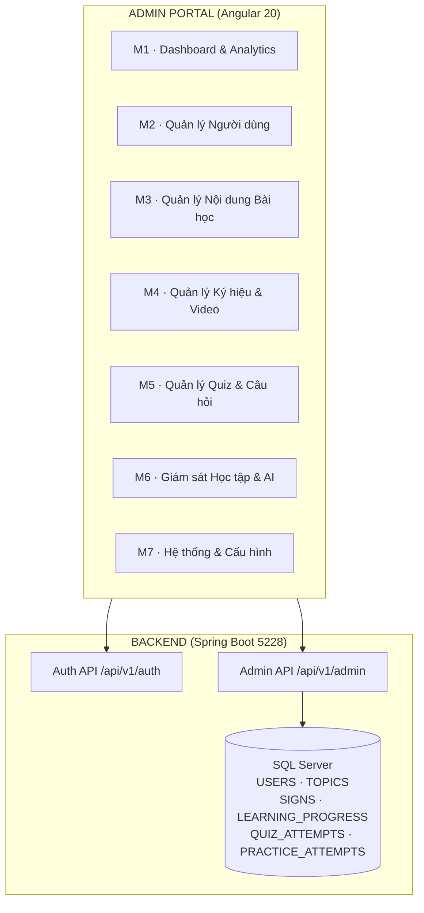
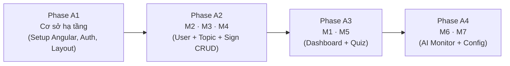

# Kế hoạch Thiết kế Admin Portal — Hệ thống Học Ngôn ngữ Ký hiệu VSL

> **Dự án:** Hệ thống học và thực hành Ngôn ngữ ký hiệu Việt Nam (VSL) — BTL Nhóm 4  
> **Thư mục admin:** `d:\ky1nam4\TTNM\admin\`  
> **Style tham khảo:** `d:\ky1nam4\TTNM\2.FrontEnd\` (Angular 20, Ng-Zorro Ant Design, Bootstrap Icons, ApexCharts)  
> **Stack:** Angular 20 · Ng-Zorro Ant Design · ApexCharts / Ng-ApexCharts · Lucide Angular · SignalR (realtime)  
> **Backend:** Spring Boot 3.4.2 (port `5228`) · SQL Server (`sso.d2s.com.vn:2025/VSL`)  
> **Role duy nhất:** `ADMIN` — được phân biệt bởi `USERS.role = 'ADMIN'`

---

## Sơ đồ Kiến trúc Tổng thể



---

## MODULE 1 — Dashboard & Analytics

> **Mục đích:** Cung cấp bức tranh tổng quan hệ thống ngay khi Admin đăng nhập.

### 1.1. KPI Cards (Thẻ chỉ số nhanh)

| Chỉ số | Nguồn dữ liệu DB | Hiển thị |
|:---|:---|:---|
| Tổng học viên | `COUNT(USERS)` | Số + % tăng so với tháng trước |
| Học viên hoạt động hôm nay | `USERS.streak_days` cập nhật hôm nay | Badge "Đang online" |
| Tổng ký hiệu đã có | `COUNT(SIGNS)` | Số tuyệt đối |
| Tỷ lệ hoàn thành bài học TB | `AVG(mastery_score)` | % thanh tiến độ |
| Lượt luyện AI hôm nay | `COUNT(PRACTICE_ATTEMPTS)` ngày hôm nay | Số |
| Điểm chuẩn AI trung bình | `AVG(PRACTICE_ATTEMPTS.confidence)` | % |

### 1.2. Biểu đồ Hoạt động Hệ thống

- **Biểu đồ đường (Line Chart):** Số học viên đăng nhập mỗi ngày trong 30 ngày qua
- **Biểu đồ cột (Bar Chart):** Số lượt thực hành AI theo từng chủ đề (8 cột)
- **Biểu đồ tròn (Donut Chart):** Phân bổ học viên theo cấp độ (Level 1–5)
- **Heatmap hoạt động:** Mỗi ô = 1 ngày trong 12 tuần gần nhất (giống GitHub contribution)

### 1.3. Bảng Hoạt động Gần đây (Activity Feed)

- Danh sách cuộn 20 sự kiện mới nhất: đăng ký mới, hoàn thành quiz, đạt mastery
- Lọc theo loại sự kiện: Đăng ký · Quiz · Thực hành AI · Đạt chuẩn

### 1.4. Top Bảng xếp hạng (Leaderboard Preview)

- Top 5 học viên có XP cao nhất tuần này
- Top 5 chủ đề được học nhiều nhất

---

## MODULE 2 — Quản lý Người dùng

> **Mục đích:** CRUD đầy đủ tài khoản học viên; khoá/mở khóa, phân quyền, theo dõi tiến độ cá nhân.

### 2.1. Danh sách Học viên

- **Bảng dữ liệu** với phân trang 20 dòng/trang (Ng-Zorro Table)
- **Cột hiển thị:** Avatar · Họ tên · Email · Cấp độ · XP · Streak · Trạng thái · Ngày tạo · Hành động
- **Tìm kiếm:** Theo tên hoặc email (debounce 300ms)
- **Lọc:** Trạng thái (Hoạt động / Bị khóa) · Cấp độ · Khoảng ngày tham gia
- **Sắp xếp:** XP giảm dần / ngày tạo mới nhất

### 2.2. Thêm / Chỉnh sửa Học viên

- Form modal (Ng-Zorro Drawer hoặc Modal): Họ tên · Email · Mật khẩu (tạo mới) · Số điện thoại · Avatar URL · Vai trò (STUDENT / ADMIN)
- Validation: Email unique · Mật khẩu ≥ 8 ký tự · Trường bắt buộc

### 2.3. Khóa / Mở khóa Tài khoản

- Toggle trạng thái `USERS.status` (1 → 0 → 1)
- Confirm dialog trước khi thực hiện
- Học viên bị khóa không thể đăng nhập

### 2.4. Xem Chi tiết & Hồ sơ Học tập

- Thông tin cá nhân đầy đủ
- **Stats cá nhân:** Tổng XP · Cấp độ · Streak days · Số ký hiệu đã thuần thục
- **Biểu đồ tiến độ cá nhân:** Số lượt thực hành AI theo ngày (14 ngày)
- **Lịch sử Quiz:** Bảng 10 bài gần nhất (chủ đề, điểm, ngày)
- **Tiến độ từng chủ đề:** 8 thanh tiến độ ngang

### 2.5. Reset Mật khẩu

- Admin có thể reset mật khẩu về mặc định hoặc nhập mật khẩu mới
- Không cần gửi email (nội bộ BTL)

---

## MODULE 3 — Quản lý Nội dung Bài học (Topics)

> **Mục đích:** CRUD chủ đề bài học, sắp xếp thứ tự, khoá/mở khóa chủ đề.

### 3.1. Danh sách Chủ đề

- **Bảng + Card view** có thể chuyển đổi
- **Cột:** STT · Emoji · Tên chủ đề · Cấp độ · Danh mục · Số ký hiệu · Thứ tự · Trạng thái · Hành động
- **Lọc:** Cấp độ (Nhập môn / Cơ bản / Trung cấp / Nâng cao) · Danh mục (single / phrases) · Trạng thái

### 3.2. Thêm / Chỉnh sửa Chủ đề

- **Form fields:** Tên chủ đề (vi) · Emoji picker · Cấp độ · Danh mục · Mô tả · Thứ tự hiển thị · Trạng thái
- Inline preview của thẻ chủ đề (giống giao diện mobile app)

### 3.3. Kích hoạt / Ẩn Chủ đề

- Toggle `TOPICS.is_active`
- Cảnh báo nếu chủ đề đang có học viên đang học

### 3.4. Sắp xếp Thứ tự Drag & Drop

- Kéo thả để sắp xếp `display_order` của 8 chủ đề
- Lưu thứ tự mới qua API batch update

---

## MODULE 4 — Quản lý Ký hiệu & Video (Signs)

> **Mục đích:** CRUD ký hiệu ngôn ngữ — trung tâm nội dung của toàn bộ ứng dụng.

### 4.1. Danh sách Ký hiệu

- **Bảng** phân trang 25 dòng/trang
- **Cột:** Thumbnail · Tên tiếng Việt · IPA · Tiếng Anh · Chủ đề · Độ khó · Thời lượng · Trạng thái · Hành động
- **Tìm kiếm:** Tên từ (vi/en) với debounce
- **Lọc:** Chủ đề · Độ khó (1/2/3) · Loại nội dung (sign/sentence) · Trạng thái
- **Xem trước thumbnail** inline khi hover

### 4.2. Thêm / Chỉnh sửa Ký hiệu

- **Tab 1 — Thông tin cơ bản:** Tên vi · IPA · Tên tiếng Anh · Chủ đề (dropdown) · Loại nội dung · Độ khó · Thời lượng video
- **Tab 2 — Video & Hình ảnh:** URL video mẫu · URL thumbnail · Preview video nhúng (Oven Player hoặc `<video>`)
- **Tab 3 — Chi tiết cử chỉ:** Editor JSON các bước (steps_json) với form dynamic (thêm/xóa từng bước) · Lưu ý văn hóa (cultural_note)
- **Preview realtime:** Panel bên phải xem trước như màn hình mobile SignDetailScreen

### 4.3. Quản lý theo Chủ đề

- Chọn chủ đề → xem toàn bộ ký hiệu thuộc chủ đề đó
- Drag & drop thứ tự ký hiệu trong chủ đề

### 4.4. Import Hàng loạt (Batch Import)

- Upload file CSV/Excel (dùng `exceljs`) để nạp nhiều ký hiệu cùng lúc
- Xem trước dữ liệu trước khi import (preview table)
- Báo lỗi từng dòng nếu thiếu trường bắt buộc

### 4.5. Kích hoạt / Ẩn Ký hiệu

- Toggle `SIGNS.is_active`
- Hiển thị cảnh báo nếu ký hiệu đang có tiến độ học của học viên

---

## MODULE 5 — Quản lý Quiz & Câu hỏi

> **Mục đích:** Cấu hình bộ câu hỏi trắc nghiệm cho từng chủ đề; xem lịch sử kết quả.

### 5.1. Cấu hình Quiz theo Chủ đề

- Chọn chủ đề → cấu hình: Số câu hỏi mỗi lần (3 / 5 / 10) · Thời gian mỗi câu (giây) · Thứ tự ngẫu nhiên
- Lưu cấu hình vào bảng `TOPICS` (thêm trường cấu hình) hoặc bảng `QUIZ_CONFIG` riêng

### 5.2. Danh sách Câu hỏi Quiz

- Bảng câu hỏi: Video/ký hiệu · Đáp án đúng · 3 đáp án sai · Giải thích
- Thêm / Chỉnh sửa câu hỏi: Chọn ký hiệu từ danh sách SIGNS làm câu hỏi · Nhập 4 phương án A/B/C/D · Đánh dấu đáp án đúng · Nhập giải thích ngữ pháp

### 5.3. Lịch sử Kết quả Quiz

- Bảng lịch sử `QUIZ_ATTEMPTS`: Học viên · Chủ đề · Điểm · Số câu đúng/tổng · Thời gian làm
- Lọc: Theo chủ đề · Khoảng điểm · Khoảng ngày
- Xuất Excel kết quả (dùng `exceljs`)
- Biểu đồ: Phân bổ điểm số (histogram) · Điểm trung bình theo chủ đề

---

## MODULE 6 — Giám sát Học tập & AI Camera

> **Mục đích:** Theo dõi hiệu quả học tập của học viên và hiệu suất mô hình AI nhận diện cử chỉ.

### 6.1. Tổng quan Tiến độ Học tập

- **Heatmap chủ đề × học viên:** Mỗi ô = % hoàn thành của 1 học viên trong 1 chủ đề
- **Biểu đồ tương tác:** Click vào ô để xem chi tiết học viên đó với chủ đề đó
- **Bảng top từ khó:** Ký hiệu nào có mastery_score thấp nhất (học viên học lâu nhất chưa thuần thục)

### 6.2. Giám sát Thực hành AI Camera

- **Bảng lịch sử** `PRACTICE_ATTEMPTS` gần nhất: Học viên · Ký hiệu · Nhãn AI dự đoán · Độ tin cậy · Đúng/Sai · Thời gian
- **Lọc:** Chỉ hiển thị lần sai · Theo ký hiệu cụ thể · Theo học viên
- **Biểu đồ Accuracy theo ký hiệu:** Bar chart 8–10 ký hiệu có tỷ lệ sai nhiều nhất
- **Phân tích nhãn sai:** Heatmap confusion matrix nhỏ (nhãn thật × nhãn AI dự đoán)

### 6.3. Báo cáo Streak & Engagement

- Bảng học viên + streak_days hiện tại · Streak kỷ lục · Ngày cuối hoạt động
- Cảnh báo: Học viên không hoạt động > 7 ngày (badge màu đỏ)

---

## MODULE 7 — Hệ thống & Cấu hình

> **Mục đích:** Quản lý cấu hình hệ thống, tài khoản admin, và giám sát sức khỏe server.

### 7.1. Quản lý Tài khoản Admin

- Danh sách tài khoản có `role = 'ADMIN'`
- Thêm tài khoản Admin mới
- Đổi mật khẩu Admin

### 7.2. Cấu hình Hệ thống

- **Thông số AI:** Ngưỡng confidence chấp nhận (mặc định 0.85) · Số khung hình phân tích (30)
- **Gamification:** Số XP mỗi lần mastery · Số XP mỗi quiz đúng · Điều kiện lên cấp
- **Cấu hình Streak:** Số giờ trong ngày để tính streak (mặc định 24h)

### 7.3. Giám sát Sức khỏe Hệ thống

- **API Health Check:** Ping BE (Spring Boot :5228) · Ping AI Service (FastAPI) · Trạng thái DB
- **Badge trạng thái:** 🟢 Online · 🟡 Chậm (>500ms) · 🔴 Offline
- **Realtime log:** Kết nối SignalR để stream log 20 dòng cuối từ BE

### 7.4. Nhật ký Hoạt động Admin (Audit Log)

- Ghi lại mọi thao tác CRUD của Admin: Ai · Làm gì · Lúc nào · Đối tượng nào
- Lọc theo admin · Loại hành động · Khoảng ngày

---

## Lộ trình Triển khai Admin Portal



### Phase A1 — Cơ sở hạ tầng Admin

- Khởi tạo Angular project `admin/` với Ng-Zorro, ApexCharts, Lucide
- Layout chính: Sidebar dọc (8 menu item) + Header + Content area
- Auth Guard: Chỉ cho phép `role = 'ADMIN'` truy cập
- Login page riêng cho Admin (re-use API `/api/v1/auth/login`)
- HTTP Interceptor gắn Bearer Token mọi request
- Shared components: Page header · Breadcrumb · Empty state · Loading skeleton

### Phase A2 — Module M2, M3, M4 (CRUD cốt lõi)

- M2: Danh sách học viên + CRUD + Khóa tài khoản
- M3: CRUD chủ đề + Drag & Drop thứ tự
- M4: CRUD ký hiệu + Preview video + Batch import CSV

### Phase A3 — Module M1, M5 (Dashboard + Quiz)

- M1: KPI cards + 4 biểu đồ ApexCharts + Activity feed
- M5: Cấu hình quiz + Lịch sử kết quả + Xuất Excel

### Phase A4 — Module M6, M7 (Nâng cao)

- M6: Heatmap tiến độ + Giám sát AI + Confusion matrix mini
- M7: Health check realtime + Audit log + Cấu hình hệ thống

---

## Cấu trúc Thư mục Đề xuất

```
admin/
├── src/
│   └── app/
│       ├── core/
│       │   ├── guards/           # admin-auth.guard.ts
│       │   ├── interceptors/     # jwt.interceptor.ts
│       │   └── services/         # auth.service.ts, api.service.ts
│       ├── features/
│       │   ├── dashboard/        # M1
│       │   ├── users/            # M2
│       │   ├── topics/           # M3
│       │   ├── signs/            # M4
│       │   ├── quiz/             # M5
│       │   ├── monitoring/       # M6
│       │   └── system/           # M7
│       └── shared/
│           ├── components/       # kpi-card, stat-chart, data-table...
│           ├── layouts/          # admin-layout, sidebar, header
│           └── models/           # user.model, topic.model, sign.model...
├── angular.json
├── package.json
└── tsconfig.json
```
