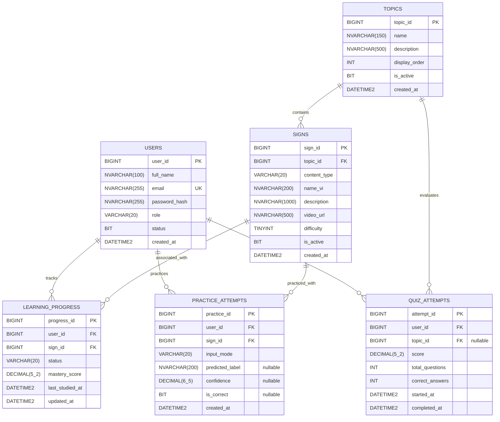

# Thiết kế Cơ sở Dữ liệu Hệ thống Học Ngôn ngữ Ký hiệu Việt Nam (VSL-DB)

> **Hệ quản trị CSDL đề xuất:** Microsoft SQL Server (hoặc tương thích PostgreSQL / MySQL)  
> **Dự án:** Hệ thống học và thực hành Ngôn ngữ ký hiệu Việt Nam (VSL) - BTL Nhóm 4  
> **Phiên bản:** 1.0.0

---

## 1. Sơ đồ Quan hệ Thực thể (Entity Relationship Diagram - ERD)



---

## 2. Chi tiết Danh sách Bảng và Thuộc tính

### 2.1. Bảng `USERS` (Người dùng)
Lưu trữ thông tin tài khoản người học và quản trị viên của hệ thống.

| Tên trường | Kiểu dữ liệu | Ràng buộc | Cho phép NULL | Mô tả |
| :--- | :--- | :--- | :---: | :--- |
| `user_id` | `BIGINT` | PRIMARY KEY, IDENTITY(1,1) | Không | Khóa chính, định danh duy nhất cho người dùng |
| `full_name` | `NVARCHAR(100)` | | Không | Họ và tên hiển thị của người dùng |
| `email` | `NVARCHAR(255)` | UNIQUE, INDEX | Không | Email đăng nhập, định danh tài khoản duy nhất |
| `password_hash` | `NVARCHAR(255)` | | Không | Mật khẩu đã được băm an toàn (BCrypt / Argon2) |
| `role` | `VARCHAR(20)` | DEFAULT `'STUDENT'` | Không | Vai trò trong hệ thống: `STUDENT`, `ADMIN` |
| `status` | `BIT` | DEFAULT `1` | Không | Trạng thái tài khoản: `1` (Active/Kích hoạt), `0` (Locked/Khóa) |
| `created_at` | `DATETIME2` | DEFAULT `GETDATE()` | Không | Thời điểm đăng ký tài khoản |

---

### 2.2. Bảng `TOPICS` (Chủ đề bài học)
Phân loại từ vựng và câu ký hiệu theo các ngữ cảnh giao tiếp (chào hỏi, gia đình, số đếm, màu sắc, y tế,...).

| Tên trường | Kiểu dữ liệu | Ràng buộc | Cho phép NULL | Mô tả |
| :--- | :--- | :--- | :---: | :--- |
| `topic_id` | `BIGINT` | PRIMARY KEY, IDENTITY(1,1) | Không | Khóa chính, định danh duy nhất của chủ đề |
| `name` | `NVARCHAR(150)` | | Không | Tên chủ đề (ví dụ: "Chào hỏi thông dụng", "Số đếm & Thời gian") |
| `description` | `NVARCHAR(500)` | | Có | Mô tả ngắn gọn nội dung và mục tiêu của chủ đề |
| `display_order` | `INT` | DEFAULT `0` | Không | Thứ tự hiển thị trên giao diện người dùng |
| `is_active` | `BIT` | DEFAULT `1` | Không | Trạng thái mở/đóng chủ đề: `1` (Hiển thị), `0` (Ẩn) |
| `created_at` | `DATETIME2` | DEFAULT `GETDATE()` | Không | Thời điểm tạo chủ đề |

---

### 2.3. Bảng `SIGNS` (Ký hiệu / Từ vựng / Câu)
Lưu trữ chi tiết các ký hiệu đơn lẻ hoặc mẫu câu trong bộ dữ liệu VSL.

| Tên trường | Kiểu dữ liệu | Ràng buộc | Cho phép NULL | Mô tả |
| :--- | :--- | :--- | :---: | :--- |
| `sign_id` | `BIGINT` | PRIMARY KEY, IDENTITY(1,1) | Không | Khóa chính, định danh duy nhất cho ký hiệu |
| `topic_id` | `BIGINT` | FOREIGN KEY (`TOPICS.topic_id`) | Không | Thuộc chủ đề nào |
| `content_type` | `VARCHAR(20)` | DEFAULT `'sign'` | Không | Loại nội dung: `'sign'` (từ/ký hiệu đơn), `'sentence'` (câu liên tục) |
| `name_vi` | `NVARCHAR(200)` | | Không | Tên hoặc nhãn tiếng Việt (ví dụ: "Xin chào", "Cảm ơn", "Tạm biệt") |
| `description` | `NVARCHAR(1000)`| | Có | Hướng dẫn kỹ thuật thực hiện: hình bàn tay, hướng, chuyển động |
| `video_url` | `NVARCHAR(500)` | | Không | Đường dẫn URL video minh họa ký hiệu chuẩn (CDN/S3/Storage) |
| `difficulty` | `TINYINT` | DEFAULT `1` | Không | Độ khó: `1` (Dễ/Cơ bản), `2` (Trung bình), `3` (Nâng cao) |
| `is_active` | `BIT` | DEFAULT `1` | Không | Trạng thái sử dụng: `1` (Đang dùng), `0` (Tạm ngưng) |
| `created_at` | `DATETIME2` | DEFAULT `GETDATE()` | Không | Thời điểm tạo ký hiệu |

---

### 2.4. Bảng `LEARNING_PROGRESS` (Tiến độ học tập)
Theo dõi trạng thái và mức độ thành thạo của từng học viên đối với từng ký hiệu.

| Tên trường | Kiểu dữ liệu | Ràng buộc | Cho phép NULL | Mô tả |
| :--- | :--- | :--- | :---: | :--- |
| `progress_id` | `BIGINT` | PRIMARY KEY, IDENTITY(1,1) | Không | Khóa chính |
| `user_id` | `BIGINT` | FOREIGN KEY (`USERS.user_id`) | Không | Mã định danh người học |
| `sign_id` | `BIGINT` | FOREIGN KEY (`SIGNS.sign_id`) | Không | Ký hiệu đang theo dõi tiến độ |
| `status` | `VARCHAR(20)` | DEFAULT `'not_started'` | Không | Trạng thái: `'not_started'`, `'in_progress'`, `'mastered'` |
| `mastery_score`| `DECIMAL(5,2)` | DEFAULT `0.00` | Không | Điểm thành thạo (thang 0.00 - 100.00%) |
| `last_studied_at`| `DATETIME2` | | Có | Thời điểm gần nhất học/luyện tập ký hiệu này |
| `updated_at` | `DATETIME2` | DEFAULT `GETDATE()` | Không | Thời điểm cập nhật tiến độ |

> **Ràng buộc duy nhất (Unique Index):** Cặp `(user_id, sign_id)` nên được đặt `UNIQUE` để tránh nhân bản dữ liệu tiến độ cho cùng một ký hiệu.

---

### 2.5. Bảng `QUIZ_ATTEMPTS` (Lượt làm bài kiểm tra trắc nghiệm)
Lưu kết quả các bài kiểm tra trắc nghiệm (nhận diện qua video/hình ảnh).

| Tên trường | Kiểu dữ liệu | Ràng buộc | Cho phép NULL | Mô tả |
| :--- | :--- | :--- | :---: | :--- |
| `attempt_id` | `BIGINT` | PRIMARY KEY, IDENTITY(1,1) | Không | Khóa chính lượt kiểm tra |
| `user_id` | `BIGINT` | FOREIGN KEY (`USERS.user_id`) | Không | Người thực hiện bài kiểm tra |
| `topic_id` | `BIGINT` | FOREIGN KEY (`TOPICS.topic_id`) | Có | Chủ đề kiểm tra (NULL nếu là bài kiểm tra tổng hợp) |
| `score` | `DECIMAL(5,2)` | | Không | Điểm số đạt được (thang 0.00 - 100.00) |
| `total_questions`| `INT` | | Không | Tổng số câu hỏi trong bài kiểm tra |
| `correct_answers`| `INT` | | Không | Số lượng câu trả lời đúng |
| `started_at` | `DATETIME2` | DEFAULT `GETDATE()` | Không | Thời gian bắt đầu làm bài |
| `completed_at` | `DATETIME2` | | Có | Thời gian hoàn thành bài kiểm tra |

---

### 2.6. Bảng `PRACTICE_ATTEMPTS` (Lượt thực hành cử chỉ với AI)
Lưu lại lịch sử các phiên người học bật webcam hoặc tải video lên để hệ thống AI nhận diện và chấm điểm.

| Tên trường | Kiểu dữ liệu | Ràng buộc | Cho phép NULL | Mô tả |
| :--- | :--- | :--- | :---: | :--- |
| `practice_id` | `BIGINT` | PRIMARY KEY, IDENTITY(1,1) | Không | Khóa chính của phiên thực hành |
| `user_id` | `BIGINT` | FOREIGN KEY (`USERS.user_id`) | Không | Người thực hành |
| `sign_id` | `BIGINT` | FOREIGN KEY (`SIGNS.sign_id`) | Không | Ký hiệu mục tiêu cần thực hiện |
| `input_mode` | `VARCHAR(20)` | DEFAULT `'camera'` | Không | Phương thức nạp đầu vào: `'camera'` (trực tiếp) hoặc `'upload'` (tải video) |
| `predicted_label`| `NVARCHAR(200)`| | Có | Nhãn ký hiệu mà mô hình AI dự đoán |
| `confidence` | `DECIMAL(6,5)` | | Có | Độ tin cậy dự đoán của AI (từ 0.00000 đến 1.00000) |
| `is_correct` | `BIT` | | Có | Kết quả đánh giá: `1` (Chính xác), `0` (Sai/Chưa khớp) |
| `created_at` | `DATETIME2` | DEFAULT `GETDATE()` | Không | Thời điểm thực hiện |

---

## 3. Mối quan hệ giữa các Thực thể (Entity Relationships)

1. **`USERS` (1) ─── (N) `LEARNING_PROGRESS`**:  
   - Một người dùng có nhiều bản ghi tiến độ học tập tương ứng với các ký hiệu khác nhau.  
   - Khóa ngoại: `LEARNING_PROGRESS.user_id` tham chiếu `USERS.user_id`.
2. **`USERS` (1) ─── (N) `QUIZ_ATTEMPTS`**:  
   - Một người dùng có thể thực hiện nhiều lần thi trắc nghiệm theo thời gian.  
   - Khóa ngoại: `QUIZ_ATTEMPTS.user_id` tham chiếu `USERS.user_id`.
3. **`USERS` (1) ─── (N) `PRACTICE_ATTEMPTS`**:  
   - Một người dùng có thể thực hiện nhiều lượt luyện tập qua camera/video với AI.  
   - Khóa ngoại: `PRACTICE_ATTEMPTS.user_id` tham chiếu `USERS.user_id`.
4. **`TOPICS` (1) ─── (N) `SIGNS`**:  
   - Một chủ đề bài học bao gồm nhiều từ vựng / câu ký hiệu.  
   - Khóa ngoại: `SIGNS.topic_id` tham chiếu `TOPICS.topic_id`.
5. **`TOPICS` (1) ─── (N) `QUIZ_ATTEMPTS`**:  
   - Một chủ đề có thể liên kết với nhiều lượt làm bài trắc nghiệm của chủ đề đó (hoặc `NULL` đối với bài kiểm tra tổng hợp toàn diện).  
   - Khóa ngoại: `QUIZ_ATTEMPTS.topic_id` tham chiếu `TOPICS.topic_id`.
6. **`SIGNS` (1) ─── (N) `LEARNING_PROGRESS`**:  
   - Mỗi ký hiệu được theo dõi tiến độ bởi nhiều học viên khác nhau.  
   - Khóa ngoại: `LEARNING_PROGRESS.sign_id` tham chiếu `SIGNS.sign_id`.
7. **`SIGNS` (1) ─── (N) `PRACTICE_ATTEMPTS`**:  
   - Mỗi ký hiệu được thực hành nhiều lần bởi các học viên.  
   - Khóa ngoại: `PRACTICE_ATTEMPTS.sign_id` tham chiếu `SIGNS.sign_id`.

---

## 4. Mã Nguồn Tạo Bảng (SQL Server DDL Script)

```sql
-- 1. Bảng USERS
CREATE TABLE USERS (
    user_id BIGINT IDENTITY(1,1) PRIMARY KEY,
    full_name NVARCHAR(100) NOT NULL,
    email NVARCHAR(255) NOT NULL UNIQUE,
    password_hash NVARCHAR(255) NOT NULL,
    role VARCHAR(20) NOT NULL DEFAULT 'STUDENT',
    status BIT NOT NULL DEFAULT 1,
    created_at DATETIME2 NOT NULL DEFAULT GETDATE()
);

-- 2. Bảng TOPICS
CREATE TABLE TOPICS (
    topic_id BIGINT IDENTITY(1,1) PRIMARY KEY,
    name NVARCHAR(150) NOT NULL,
    description NVARCHAR(500) NULL,
    display_order INT NOT NULL DEFAULT 0,
    is_active BIT NOT NULL DEFAULT 1,
    created_at DATETIME2 NOT NULL DEFAULT GETDATE()
);

-- 3. Bảng SIGNS
CREATE TABLE SIGNS (
    sign_id BIGINT IDENTITY(1,1) PRIMARY KEY,
    topic_id BIGINT NOT NULL,
    content_type VARCHAR(20) NOT NULL DEFAULT 'sign',
    name_vi NVARCHAR(200) NOT NULL,
    description NVARCHAR(1000) NULL,
    video_url NVARCHAR(500) NOT NULL,
    difficulty TINYINT NOT NULL DEFAULT 1,
    is_active BIT NOT NULL DEFAULT 1,
    created_at DATETIME2 NOT NULL DEFAULT GETDATE(),
    CONSTRAINT FK_Signs_Topics FOREIGN KEY (topic_id) REFERENCES TOPICS(topic_id)
);

-- 4. Bảng LEARNING_PROGRESS
CREATE TABLE LEARNING_PROGRESS (
    progress_id BIGINT IDENTITY(1,1) PRIMARY KEY,
    user_id BIGINT NOT NULL,
    sign_id BIGINT NOT NULL,
    status VARCHAR(20) NOT NULL DEFAULT 'not_started',
    mastery_score DECIMAL(5,2) NOT NULL DEFAULT 0.00,
    last_studied_at DATETIME2 NULL,
    updated_at DATETIME2 NOT NULL DEFAULT GETDATE(),
    CONSTRAINT FK_Progress_Users FOREIGN KEY (user_id) REFERENCES USERS(user_id),
    CONSTRAINT FK_Progress_Signs FOREIGN KEY (sign_id) REFERENCES SIGNS(sign_id),
    CONSTRAINT UQ_User_Sign UNIQUE (user_id, sign_id)
);

-- 5. Bảng QUIZ_ATTEMPTS
CREATE TABLE QUIZ_ATTEMPTS (
    attempt_id BIGINT IDENTITY(1,1) PRIMARY KEY,
    user_id BIGINT NOT NULL,
    topic_id BIGINT NULL,
    score DECIMAL(5,2) NOT NULL DEFAULT 0.00,
    total_questions INT NOT NULL,
    correct_answers INT NOT NULL,
    started_at DATETIME2 NOT NULL DEFAULT GETDATE(),
    completed_at DATETIME2 NULL,
    CONSTRAINT FK_Quiz_Users FOREIGN KEY (user_id) REFERENCES USERS(user_id),
    CONSTRAINT FK_Quiz_Topics FOREIGN KEY (topic_id) REFERENCES TOPICS(topic_id)
);

-- 6. Bảng PRACTICE_ATTEMPTS
CREATE TABLE PRACTICE_ATTEMPTS (
    practice_id BIGINT IDENTITY(1,1) PRIMARY KEY,
    user_id BIGINT NOT NULL,
    sign_id BIGINT NOT NULL,
    input_mode VARCHAR(20) NOT NULL DEFAULT 'camera',
    predicted_label NVARCHAR(200) NULL,
    confidence DECIMAL(6,5) NULL,
    is_correct BIT NULL,
    created_at DATETIME2 NOT NULL DEFAULT GETDATE(),
    CONSTRAINT FK_Practice_Users FOREIGN KEY (user_id) REFERENCES USERS(user_id),
    CONSTRAINT FK_Practice_Signs FOREIGN KEY (sign_id) REFERENCES SIGNS(sign_id)
);
```
