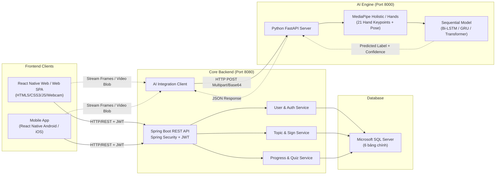
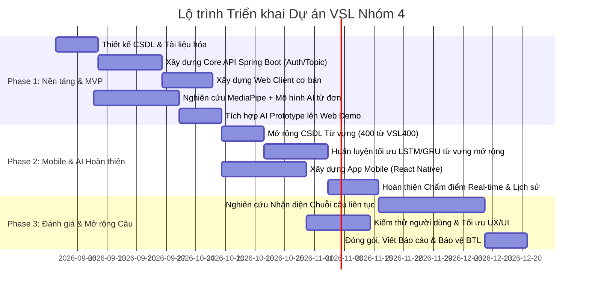

# Kế hoạch Triển khai & Phân chia Giai đoạn (VSL-Phase)

> **Dự án:** Hệ thống học và thực hành Ngôn ngữ ký hiệu Việt Nam (VSL)  
> **Nhóm thực hiện:** Nhóm 4 - BTL Tương tác người máy / Phát triển ứng dụng  
> **Kiến trúc tổng thể:** Microservices/Client-Server tách biệt giữa Client, Core Backend (Java Spring Boot) và AI Service (Python FastAPI).

---

## 1. Tổng quan Kiến trúc & Ngăn xếp Công nghệ (Tech Stack)

---

## 2. Lộ trình Phân chia Giai đoạn (Phase Breakdown)

---

## 3. Danh mục Chi tiết Module & Chức năng theo Từng Phase

---

### GIAI ĐOẠN 1 (PHASE 1): Xây dựng Nền tảng, Core Backend & Web MVP Demo

*Mục tiêu chính:* Hoàn thành luồng học cơ bản trên nền tảng Web, kết nối CSDL và tích hợp thử nghiệm mô hình AI nhận diện cử chỉ đơn thông qua webcam/upload video.

#### Module 1.1: Quản lý Xác thực & Người dùng (Auth & User Module)
* **Các chức năng cần làm:**
  1. Đăng ký tài khoản người học (Full Name, Email, Password).
  2. Đăng nhập hệ thống, phát sinh và xác thực JSON Web Token (JWT).
  3. Phân quyền người dùng: `STUDENT` (học viên) và `ADMIN` (quản trị viên).
  4. Quản lý thông tin hồ sơ cá nhân và đổi mật khẩu.
* **Cách thực hiện:**
  - **Backend (Spring Boot):** Sử dụng `Spring Security 6` kết hợp thư viện `jjwt`. Mật khẩu được mã hóa một chiều qua thuật toán `BCryptPasswordEncoder`. Tạo bảng `USERS` trên Microsoft SQL Server. Cấu hình Filter `JwtAuthenticationFilter` để kiểm tra Bearer token trong Header các request yêu cầu bảo mật.
  - **Frontend:** Thiết kế màn hình Đăng ký / Đăng nhập, lưu trữ token tại `localStorage` (Web) hoặc `AsyncStorage` (Mobile), cấu hình Axios Interceptor tự động gán Token vào header `Authorization: Bearer <token>`.

#### Module 1.2: Quản lý Nội dung Học tập (Topic & Sign Learning Module)
* **Các chức năng cần làm:**
  1. Xem danh sách các chủ đề giao tiếp cơ bản (Chào hỏi, Gia đình, Số đếm...).
  2. Xem danh sách từ vựng/câu ký hiệu trong từng chủ đề.
  3. Xem chi tiết ký hiệu: Video mẫu chuyển động chuẩn, mô tả hướng di chuyển tay, mức độ khó (`difficulty`), vị trí ngón tay.
  4. Quản trị nội dung (CRUD Chủ đề và Ký hiệu dành cho Admin).
* **Cách thực hiện:**
  - **Database:** Bảng `TOPICS` và `SIGNS`. Khóa ngoại `SIGNS.topic_id` liên kết đến `TOPICS.topic_id`.
  - **Backend:** Xây dựng các API RESTful:
    - `GET /api/topics`: Lấy danh sách chủ đề hoạt động (`is_active = 1`).
    - `GET /api/topics/{id}/signs`: Lấy danh sách ký hiệu thuộc chủ đề.
    - `GET /api/signs/{id}`: Chi tiết một ký hiệu kèm `video_url`.
    - `POST/PUT/DELETE /api/admin/topics`, `/api/admin/signs`: API quản trị nội dung.
  - **Frontend:** Xây dựng màn hình Dashboard hiển thị Grid/List Card các chủ đề, màn hình chi tiết ký hiệu tích hợp trình phát video HTML5 / React Native Video Player với nút điều khiển tốc độ phát (0.5x, 0.75x, 1.0x) để người học quan sát kỹ.

#### Module 1.3: Module Kiểm tra Kiến thức (Quiz Module - Mức cơ bản)
* **Các chức năng cần làm:**
  1. Sinh câu hỏi trắc nghiệm tự động theo chủ đề: Hiển thị video ký hiệu -> Người dùng chọn 1 trong 4 đáp án đúng.
  2. Nộp bài kiểm tra và chấm điểm tức thì.
  3. Lưu kết quả thi vào bảng `QUIZ_ATTEMPTS`.
* **Cách thực hiện:**
  - **Backend:** 
    - Thuật toán sinh câu hỏi: Lấy ngẫu nhiên $N$ câu hỏi từ bảng `SIGNS` theo `topic_id`. Với mỗi câu hỏi, lấy ngẫu nhiên 3 nhãn sai (`distractors`) từ cùng chủ đề để tạo 4 lựa chọn.
    - API `POST /api/quizzes/submit`: Nhận danh sách câu trả lời, tính số câu đúng (`correct_answers`), điểm số (`score = correct/total * 100`), ghi nhận thời gian bắt đầu (`started_at`) và kết thúc (`completed_at`).
  - **Frontend:** Giao diện làm bài đếm thời gian, hiển thị thanh tiến độ câu hỏi, màn hình tổng kết kết quả thi.

#### Module 1.4: Tích hợp AI Thực hành Ký hiệu Đơn (AI Practice - Prototype)
* **Các chức năng cần làm:**
  1. Người học bật Camera máy tính hoặc tải tệp video cử chỉ lên.
  2. Hệ thống thu thập khung hình và gửi sang AI Service.
  3. AI trích xuất tọa độ khớp ngón tay và nhận diện từ vựng tương ứng.
  4. Trả về kết quả dự đoán (`predicted_label`), độ tin cậy (`confidence`), và đánh giá Đúng/Sai so với ký hiệu mục tiêu.
  5. Ghi nhận lượt thực hành vào bảng `PRACTICE_ATTEMPTS`.
* **Cách thực hiện:**
  - **Thu thập dữ liệu & Huấn luyện (Python):** 
    - Sử dụng bộ dữ liệu mẫu ban đầu gồm 10–20 ký hiệu giao tiếp phổ biến (trong tập VSL400).
    - Tiền xử lý video: Chuẩn hóa về $T = 30$ khung hình / chuỗi (frame sampling / interpolation).
    - Trích xuất đặc trưng: Sử dụng thư viện `mediapipe.solutions.hands` để trích xuất 21 điểm mốc tọa độ 3D $(x, y, z)$ cho mỗi bàn tay (tổng cộng 42 điểm hoặc 63 giá trị cho 1 tay, 126 giá trị cho 2 tay).
    - Kiến trúc mạng: Mạng nơ-ron học chuỗi thời gian như `Bi-directional LSTM (Bi-LSTM)` hoặc `GRU` gồm 2 lớp ẩn (Hidden size: 128), kết hợp Dropout (0.3) và lớp Dense Softmax phân loại.
  - **Triển khai AI Service:** Viết REST API bằng `FastAPI`:
    - Endpoint: `POST /api/ai/predict-sign` nhận file video (`multipart/form-data`) hoặc mảng landmarks.
  - **Tích hợp Backend:** Spring Boot đóng vai trò Gateway trung chuyển: Gọi sang FastAPI, so sánh `predicted_label` với `SIGNS.name_vi`. Nếu trùng khớp và `confidence >= threshold` (ví dụ 0.70) thì gán `is_correct = 1`. Cập nhật bảng `PRACTICE_ATTEMPTS` và `LEARNING_PROGRESS`.

---

### GIAI ĐOẠN 2 (PHASE 2): Hoàn thiện AI Nhận diện Ký hiệu Đơn & Phát triển Ứng dụng Di động

*Mục tiêu chính:* Mở rộng từ điển ký hiệu, tối ưu tốc độ nhận diện thời gian thực, xây dựng hoàn thiện ứng dụng di động (Android) và đồng bộ dữ liệu người dùng.

#### Module 2.1: Mở rộng Dữ liệu & Tối ưu Hóa Mô hình AI (Advanced AI Engine)
* **Các chức năng cần làm:**
  1. Mở rộng bộ nhận diện lên đầy đủ các từ trong tập từ vựng mục tiêu (lên đến 400 ký hiệu đơn theo bộ VSL400).
  2. Nhận diện phản hồi trực tiếp (Real-time Feedback) ngay trong lúc học viên thực hiện thao tác trước camera.
  3. Tự động nhận biết thời điểm bắt đầu và kết thúc một ký hiệu (Gesture Boundary Detection).
* **Cách thực hiện:**
  - **Huấn luyện:** Áp dụng kỹ thuật Data Augmentation trên tọa độ landmark (xoay góc nhỏ, dịch chuyển ngẫu nhiên tỉ lệ nhỏ, biến thiên tốc độ khung hình). Sử dụng hàm mất mát `CrossEntropyLoss` và bộ tối ưu `AdamW`.
  - **Nhận diện Real-time (Sliding Window):** 
    - Client giữ một hàng đợi đệm (buffer) 30 khung hình gần nhất. Mỗi khi nhận thêm 1–2 frame mới, đẩy vào mô hình suy luận.
    - Kết hợp ngưỡng xác suất (Thresholding): Chỉ kích hoạt thông báo kết quả khi một nhãn liên tục duy trì độ tin cậy vượt ngưỡng $\alpha$ (ví dụ: $> 0.85$) trong ít nhất 5 bước suy luận liên tiếp để tránh kết quả nhảy loạn xạ (flickering).

#### Module 2.2: Phát triển Ứng dụng Di động (Mobile App - React Native)
* **Các chức năng cần làm:**
  1. Cung cấp trải nghiệm học tập di động native trên hệ điều hành Android (hỗ trợ kiểm thử trực tiếp trên điện thoại qua cáp USB / Expo).
  2. Truy cập trực tiếp Camera phần cứng của điện thoại để thực hành cử chỉ ký hiệu.
  3. Đồng bộ hóa toàn bộ dữ liệu bài học, tiến độ và tài khoản với Backend Spring Boot.
* **Cách thực hiện:**
  - **Giao diện di động:** Sử dụng `React Native` với kiến trúc Component hóa, thư viện `react-navigation` (Stack Navigator, Bottom Tab Navigator).
  - **Camera Integration:** Tích hợp `react-native-vision-camera` hoặc `expo-camera` để hiển thị khung ngắm camera mượt mà. 
  - **Xử lý Frame:** Sử dụng Frame Processor của Vision Camera để trích xuất frame hoặc quay video clip ngắn 2–3 giây rồi đẩy lên API để chấm điểm.
  - **Fix layout SafeArea:** Áp dụng `react-native-safe-area-context` để giao diện không bị che khuất bởi tai thỏ (Notch), Dynamic Island hoặc thanh điều hướng hệ thống.

#### Module 2.3: Theo dõi Tiến độ & Đánh giá Thành thạo (Gamification & Progress Tracking)
* **Các chức năng cần làm:**
  1. Theo dõi chi tiết tiến trình học của từng từ vựng: `not_started` -> `in_progress` -> `mastered`.
  2. Tính toán điểm thành thạo tổng quát (`mastery_score`) dựa trên kết quả thi trắc nghiệm và độ chính xác của các lần thực hành AI.
  3. Thống kê lịch sử thực hành (`PRACTICE_ATTEMPTS`) và lịch sử kiểm tra (`QUIZ_ATTEMPTS`).
* **Cách thực hiện:**
  - **Thuật toán tính Mastery Score:**
    $$\text{Mastery Score} = (0.4 \times \text{Avg Quiz Score}) + (0.6 \times \text{AI Practice Accuracy})$$
  - Khi người dùng hoàn thành 1 phiên thực hành đạt kết quả đúng với độ tin cậy cao 3 lần liên tiếp, hệ thống cập nhật `status = 'mastered'` trong bảng `LEARNING_PROGRESS`.
  - **Frontend:** Thiết kế biểu đồ hình tròn (Pie Chart), biểu đồ cột thể hiện số từ đã thành thạo theo từng chủ đề.

---

### GIAI ĐOẠN 3 (PHASE 3): Mở rộng Nhận diện Câu Liên tục, Đánh giá Người dùng & Hoàn thiện Dự án

*Mục tiêu chính:* Nghiên cứu mở rộng khả năng nhận diện chuỗi câu ký hiệu liên tục (CSLR), kiểm thử trải nghiệm tương tác với người dùng mục tiêu, đóng gói sản phẩm và báo cáo.

#### Module 3.1: Nghiên cứu Nhận diện Ngôn ngữ Ký hiệu Liên tục (Continuous Sign Recognition - CSLR)
* **Các chức năng cần làm:**
  1. Cho phép người học thực hiện một câu hoàn chỉnh gồm 2–4 ký hiệu liên tiếp (ví dụ: "Tôi" + "học" + "ngôn ngữ ký hiệu").
  2. Trích xuất chuỗi ký hiệu và dịch thành câu tiếng Việt hoàn chỉnh có ngữ nghĩa.
* **Cách thực hiện:**
  - Sử dụng kiến trúc mạng `CNN-LSTM` hoặc `Transformer` kết hợp thuật toán căn chỉnh `CTC Loss (Connectionist Temporal Classification)` để nhận diện chuỗi mà không cần gán nhãn từng khung hình riêng lẻ.
  - Phân tách và liên kết: Áp dụng mô hình ngôn ngữ (Language Model / N-gram) hỗ trợ giải mã câu để đảm bảo ngữ pháp tiếng Việt.

#### Module 3.2: Kiểm thử, Tối ưu Hiệu năng & Đánh giá Trải nghiệm Người dùng (Testing & Optimization)
* **Các chức năng cần làm:**
  1. Kiểm thử chức năng toàn diện (Unit Testing, Integration Testing).
  2. Đo lường độ trễ (Latency) của pipeline AI (mục tiêu: thời gian phản hồi $< 500\text{ms}$ trên Web/Mobile).
  3. Kiểm thử với người dùng thực tế: khảo sát tính thân thiện, dễ nhìn của giao diện (UI/UX) đối với người học bình thường và người khiếm thính.
* **Cách thực hiện:**
  - **Backend Test:** Viết Unit Test cho Spring Boot bằng `JUnit 5` và `Mockito`.
  - **AI Optimization:** Chuyển đổi mô hình PyTorch/TensorFlow sang định dạng `ONNX Runtime` hoặc `TensorRT` để tăng tốc độ suy luận (Inference Speed).
  - **Khảo sát:** Sử dụng bảng câu hỏi SUS (System Usability Scale) để đánh giá sự hài lòng của người dùng.

#### Module 3.3: Đóng gói Triển khai & Báo cáo Tổng kết
* **Các chức năng cần làm:**
  1. Container hóa các dịch vụ bằng Docker (Docker Compose cho Spring Boot, FastAPI, SQL Server).
  2. Hoàn thiện báo cáo kỹ thuật, video demo và slide thuyết trình bài tập lớn.
